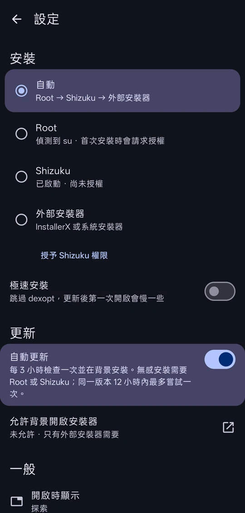

<p align="center">
  
</p>

<h1 align="center">FlitStore</h1>

<p align="center">An unofficial Android client for Tencent MyApp (应用宝)</p>

<p align="center"><a href="README.md">繁體中文</a> · English</p>

<p align="center">
  
  
  
  
</p>

## Relationship with MyApp

I wrote FlitStore because the official MyApp is bloated and full of rogue behavior.

FlitStore is not a Tencent product and has no affiliation with Tencent. Everything it shows comes from MyApp's public website (sj.qq.com), and APKs are downloaded from the links MyApp provides.

You don't need an account, and MyApp itself doesn't have to be installed. FlitStore has no ads, no analytics and no tracking. It only connects to MyApp's servers. To check for updates, it sends the package names of your installed apps to MyApp.

## Features

- Recommendations, categories, rankings and search
- App details: ratings, download count, screenshots, reviews, and other apps from the same developer
- Checks your installed apps for new versions. Update everything at once, or ignore a single version or an entire app
- With root or [Shizuku](https://shizuku.rikka.app/), apps install silently in the background with no prompt for each one. Without them, the system installer or InstallerX takes over
- Auto-update checks and installs in the background every 3 hours. It is off by default
- The download button on a MyApp web page can open the app in FlitStore instead
- The interface is in English, Traditional Chinese and Simplified Chinese. App names and descriptions come from MyApp and are in Simplified Chinese

## Download

Get the APK from [Releases](../../releases/latest). Android 7.0 or later is required.

## Building from source

You need JDK 21 and Android SDK 37.

```bash
./gradlew assembleDebug
```

The APK ends up in `app/build/outputs/apk/debug/`.

## Disclaimer

"应用宝" (MyApp) is a trademark of Tencent. Everything you see or download through FlitStore belongs to its respective developers. Install at your own discretion and risk.

## License

[GNU AGPL 3.0](LICENSE)
