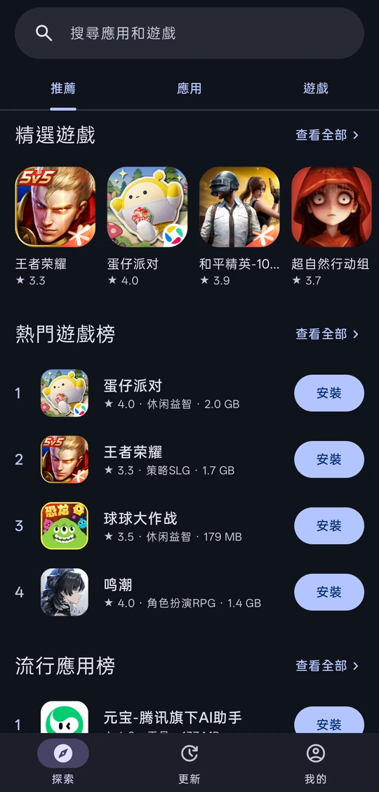
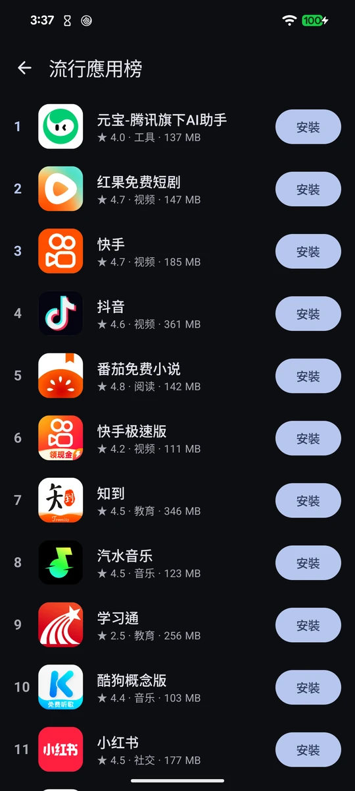
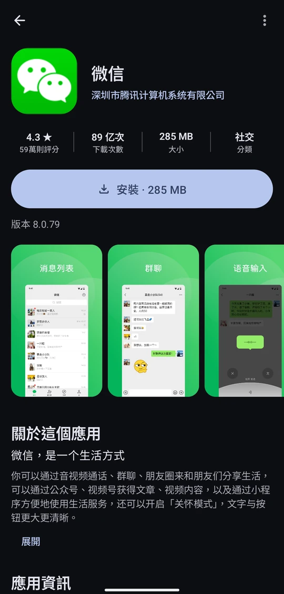
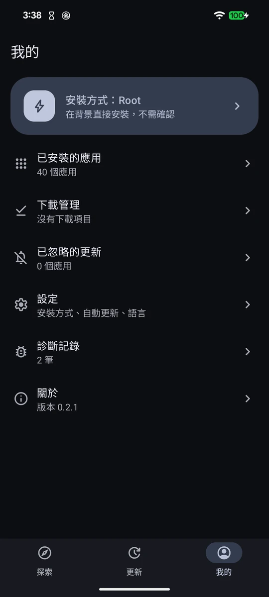

<p align="center">
  
</p>

<h1 align="center">FlitStore</h1>

<p align="center">非官方的騰訊應用寶 Android 客戶端</p>

<p align="center">繁體中文 · <a href="README.en.md">English</a></p>

<p align="center">
  
  
  
  
</p>

## 和應用寶的關係

我嫌官方的應用寶太臃腫，流氓行為又多，所以自己寫了 FlitStore。

FlitStore 不是騰訊的產品，跟騰訊也沒有合作關係。畫面上的內容都是從應用寶的公開網頁（sj.qq.com）讀來的，安裝檔也是用應用寶提供的下載連結。

不用登入，手機上也不必先裝應用寶。FlitStore 沒有廣告，也沒有統計或追蹤，連線的對象只有應用寶的伺服器。檢查更新時，會拿已安裝應用的套件名稱去應用寶查詢。

## 功能

- 推薦、分類、排行榜和搜尋
- 應用詳情：評分、下載次數、截圖、評論，還有同開發者的其他應用
- 檢查已安裝的應用有沒有新版，可以全部一起更新，也可以忽略某個版本或某個應用
- 有 Root 或 [Shizuku](https://shizuku.rikka.app/) 就在背景直接安裝，不用每個都按確認；沒有的話交給系統安裝器或 InstallerX
- 自動更新：每 3 小時在背景檢查並安裝，預設關閉
- 介面有英文、繁體中文和簡體中文。應用名稱和介紹來自應用寶，都是簡體中文

## 下載

到 [Releases](../../releases/latest) 下載 APK，需要 Android 7.0 以上。

## 從原始碼建置

需要 JDK 21 和 Android SDK 37。

```bash
./gradlew assembleDebug
```

建好的 APK 在 `app/build/outputs/apk/debug/`。

## 聲明

「應用寶」是騰訊的商標。透過 FlitStore 看到和下載的內容，版權屬於各自的開發者。安裝前請自行判斷，使用上的風險由使用者自己承擔。

## 授權

[GNU AGPL 3.0](LICENSE)
